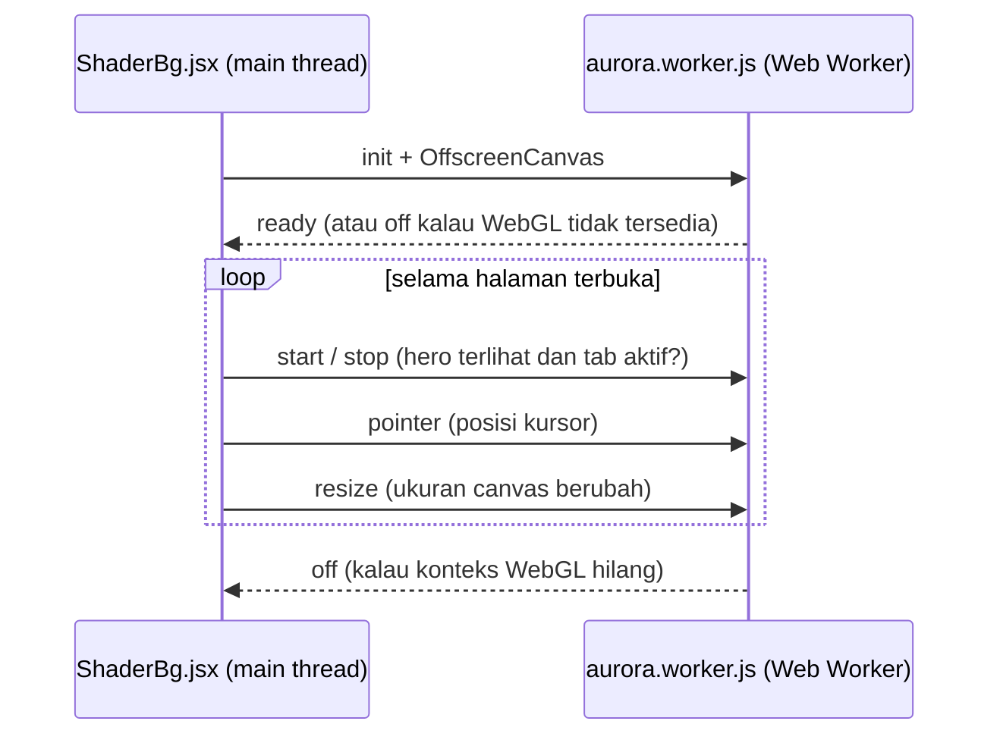

<div align="center">

# Template Portofolio

Portofolio satu halaman bertema gelap, dengan latar aurora WebGL dan kartu ID yang bisa ditarik-tarik.<br>
Dibuat pakai React dan Vite, tanpa backend.

[](https://react.dev)
[](https://vite.dev)
[](https://nodejs.org)
[](https://developer.mozilla.org/docs/Web/API/WebGL_API)
[](https://developer.mozilla.org/docs/Web/CSS)


[Mulai cepat](#cara-install-dan-menjalankan) | [Kustomisasi](#kustomisasi) | [Deploy](#build-dan-deploy)

</div>

---

Semua isi situs (profil, proyek, sertifikat, skill, kontak) diambil dari satu file, yaitu `src/data.js`. Ganti isinya dengan datamu, build, lalu upload ke hosting statis mana saja. Animasi dan efek visualnya ditulis langsung pakai API bawaan browser, jadi tidak ada library animasi yang perlu di-install.

## Daftar isi

- [Fitur](#fitur)
- [Tech stack](#tech-stack)
- [Prasyarat](#prasyarat)
- [Cara install dan menjalankan](#cara-install-dan-menjalankan)
- [Script npm](#script-npm)
- [Struktur folder](#struktur-folder)
- [Kustomisasi](#kustomisasi)
- [Testing](#testing)
- [Build dan deploy](#build-dan-deploy)
- [Di balik layar](#di-balik-layar)
- [Aksesibilitas dan dukungan browser](#aksesibilitas-dan-dukungan-browser)
- [Troubleshooting](#troubleshooting)
- [Kredit](#kredit)

## Fitur

### Hero

- Latar aurora WebGL yang bergerak pelan dan sedikit menyala di sekitar kursor. Shader-nya jalan di Web Worker (`OffscreenCanvas`) supaya main thread tidak terbebani, dan animasinya berhenti sendiri kalau hero sedang tidak terlihat.
- Efek mesin ketik yang bergantian menampilkan isi `roles`, misalnya "Frontend Developer", "Creative Coder", dan "UI Engineer".
- Kartu ID yang tergantung di tali. Kartunya bisa ditarik dan dilempar (talinya pakai simulasi fisika), diklik untuk dibalik (depan berisi profil, belakang berisi kontak), dan ikut miring mengikuti kursor. Di HP, geser kartunya ke samping untuk mengayunkannya.
- Status "Terbuka untuk proyek", tombol ajakan (CTA), dan link media sosial.

### Tentang

- Paragraf perkenalan dan statistik jumlah proyek, sertifikat, dan penghargaan yang dihitung otomatis dari data. Angkanya naik dari 0 waktu bagian ini mulai terlihat, dan statistik yang nilainya 0 tidak ditampilkan.
- Bagian "Sekarang" untuk menulis apa yang sedang kamu pelajari, kerjakan, atau dengarkan.
- Timeline pendidikan dan pengalaman.

### Portofolio

- Tiga tab: Proyek, Sertifikat & Penghargaan, dan Tech Stack. Tab yang datanya kosong tidak ditampilkan, dan tab bisa dipindah pakai tombol panah kiri/kanan.
- Filter kategori yang dibuat otomatis dari data (muncul kalau kategorinya lebih dari satu). Pergantiannya dianimasikan dengan View Transitions.
- Grid bento. Proyek dengan `featured: true` lebarnya 2 kolom, dan kartu terakhir otomatis melebar supaya baris terakhir tidak bolong.
- Efek cahaya yang mengikuti kursor di setiap kartu, warnanya sesuai warna aksen proyek.
- Modal detail pakai `<dialog>` bawaan browser, isinya deskripsi, fitur utama, teknologi, serta tombol demo dan kode.
- Proyek yang belum punya gambar otomatis dapat ilustrasi cover sesuai kategorinya.
- Daftar sertifikat (bisa diberi link), penghargaan, grup skill, dan teks berjalan (marquee) yang berhenti saat di-hover.

### Kontak

- Alamat email ukuran besar dengan tombol Salin. Kalau gagal menyalin, tombolnya membuka `mailto:` sebagai gantinya.
- Tombol Kirim email dan Chat WhatsApp. Tombol WhatsApp hanya muncul kalau nomornya diisi.
- Link media sosial, lokasi, dan status ketersediaan.

### Di seluruh halaman

- Navbar yang menandai section yang sedang dibaca, dengan menu overlay di HP.
- Progress bar scroll di bagian atas dan animasi muncul saat di-scroll. Keduanya murni CSS (scroll-driven animations).
- Link ke section tertentu, misalnya `/#portofolio`, langsung membuka halaman di section itu.
- SEO dasar: `<title>`, meta description, Open Graph, `theme-color`, `robots.txt`, dan `lang="id"`.
- Font di-host sendiri dan di-preload, jadi tampilan tidak bergeser waktu font selesai dimuat.
- Mengikuti setelan `prefers-reduced-motion`, dan bisa dipakai lewat keyboard maupun pembaca layar (lihat [Aksesibilitas dan dukungan browser](#aksesibilitas-dan-dukungan-browser)).

## Tech stack

| Bagian | Teknologi | Keterangan |
| --- | --- | --- |
| UI | [React](https://react.dev) 19.3 + React DOM | Komponen fungsi dan hooks dalam `StrictMode`. Sudah memakai fitur React 19 seperti `ref` sebagai prop biasa. |
| Build tool | [Vite](https://vite.dev) 8.3 | Dev server dengan HMR. Untuk build produksi, Vite 8 memakai Rolldown sebagai bundler dan Lightning CSS untuk minify CSS. |
| Plugin | [`@vitejs/plugin-react`](https://github.com/vitejs/vite-plugin-react) 6.1 | Mengubah JSX dan menyalakan React Fast Refresh. |
| Bahasa | JavaScript (ES Modules) + JSX | Tidak pakai TypeScript. |
| Styling | CSS biasa | Variabel CSS untuk warna dan font, `clamp()`, `color-mix()`, scroll-driven animations, View Transitions, dan fallback lewat `@supports`. CSS-nya dipisah per komponen, tanpa framework CSS. |
| Grafis | WebGL + GLSL | Shader aurora (noise fbm dan domain warp) yang dirender di Web Worker lewat `OffscreenCanvas`. Tidak pakai library 3D. |
| Fisika | JavaScript biasa | Simulasi tali (Verlet), kurva Catmull-Rom, dan pegas teredam untuk kartu ID, semuanya di `src/lib.js`. Hasilnya digambar sebagai SVG. |
| Ikon | SVG inline | Komponen `Icon` di `src/components/Icons.jsx`. |
| Font | Space Grotesk, Plus Jakarta Sans, JetBrains Mono | File `.woff2` di-host sendiri (lisensi SIL OFL) dan di-preload. |
| Testing | Test runner bawaan Node.js | `node:test` dan `node:assert/strict`, tanpa Jest atau Vitest. |

API browser yang dipakai: IntersectionObserver, ResizeObserver, Pointer Events, Clipboard API, `<dialog>`, `inert`, `matchMedia`, View Transitions API, dan Web Worker dengan `OffscreenCanvas`.

Dependency-nya sedikit. Untuk runtime cuma `react` dan `react-dom`, ditambah `vite` dan `@vitejs/plugin-react` untuk development. Tidak ada router, state manager, UI kit, library animasi, atau library ikon.

## Prasyarat

- [Node.js](https://nodejs.org) 20 (minimal 20.19) atau 22.12 ke atas. Kalau bisa, pakai versi LTS terbaru. Cek versinya dengan `node -v`.
- npm, yang sudah ikut terpasang bersama Node.js. Cek dengan `npm -v`.
- [Git](https://git-scm.com) kalau mau clone repo. Tidak wajib, karena kamu juga bisa download ZIP.
- Browser modern: Chrome, Edge, Firefox, atau Safari versi terbaru.

Batas versi Node itu datang dari Vite 8 (`^20.19.0 || >=22.12.0`), jadi Node 18, Node 21, dan Node 22 di bawah 22.12 tidak bisa dipakai. Kalau belum punya Node.js, download installer LTS dari [nodejs.org](https://nodejs.org), atau pakai version manager seperti [nvm-windows](https://github.com/coreybutler/nvm-windows), [fnm](https://github.com/Schniz/fnm), atau [nvm](https://github.com/nvm-sh/nvm).

## Cara install dan menjalankan

Versi singkatnya:

```bash
git clone https://github.com/arisyudapratama/portfolio-2.git
cd portfolio-2
npm install
npm run dev
```

Penjelasan tiap langkah ada di bawah.

### 1. Ambil kodenya

```bash
git clone https://github.com/arisyudapratama/portfolio-2.git
cd portfolio-2
```

Kalau tidak pakai Git, buka [halaman repo](https://github.com/arisyudapratama/portfolio-2), klik **Code > Download ZIP**, ekstrak, lalu buka foldernya di terminal.

### 2. Install dependency

```bash
npm install
```

npm akan membaca `package.json` dan `package-lock.json`, lalu men-download dependency ke folder `node_modules/`. Kalau ingin hasil install yang persis sama dengan lockfile (misalnya di server CI), pakai `npm ci`.

### 3. Jalankan dev server

```bash
npm run dev
```

Di terminal akan muncul kira-kira seperti ini:

```text
  VITE v8.3.5  ready in 418 ms

  ➜  Local:   http://localhost:5173/
  ➜  Network: use --host to expose
```

Buka http://localhost:5173 di browser. Setiap kali kamu menyimpan file (misalnya `src/data.js`), halaman langsung ter-update tanpa perlu di-refresh. Fitur ini namanya HMR. Untuk mematikan server, tekan `Ctrl + C` di terminal.

### 4. Buka dari HP (opsional)

```bash
npm run dev -- --host
```

Vite akan menampilkan alamat Network, misalnya `http://192.168.1.10:5173`. Buka alamat itu dari HP yang tersambung ke Wi-Fi yang sama. Cara ini berguna untuk mengecek tampilan mobile dan mencoba menggeser kartu ID pakai jari. Di Windows, izinkan Node.js kalau Windows Firewall menanyakannya.

Mau pakai port lain? Jalankan `npm run dev -- --port 3000`.

### 5. Setelah itu

1. Ganti isi `src/data.js` dengan datamu (lihat [Kustomisasi](#kustomisasi)).
2. Jalankan `npm test` untuk memastikan semua test lulus (lihat [Testing](#testing)).
3. Build, lalu upload hasilnya (lihat [Build dan deploy](#build-dan-deploy)).

## Script npm

| Perintah | Isinya | Fungsi |
| --- | --- | --- |
| `npm run dev` | `vite` | Menjalankan dev server dengan HMR di http://localhost:5173 |
| `npm run build` | `vite build` | Build produksi ke folder `dist/` (sudah di-minify dan nama file-nya diberi hash) |
| `npm run preview` | `vite preview` | Menjalankan hasil build dari `dist/` di http://localhost:4173, untuk dicek sebelum deploy |
| `npm test` | `node --test` | Menjalankan unit test di `src/lib.test.js` |

Argumen tambahan ditulis setelah `--`, misalnya `npm run dev -- --host` atau `npm run preview -- --port 8080`.

## Struktur folder

```text
portfolio-2/
├── index.html                # Halaman induk: <title>, meta SEO dan Open Graph, preload font
├── package.json              # Script dan daftar dependency
├── package-lock.json         # Versi dependency yang dikunci
├── vite.config.js            # Konfigurasi Vite (plugin React)
├── public/                   # Aset statis, disalin apa adanya ke dist/
│   ├── favicon.svg           # Ikon tab browser
│   ├── robots.txt            # Aturan untuk crawler mesin pencari
│   └── fonts/                # File font .woff2 dan lisensinya (OFL)
└── src/
    ├── main.jsx              # Titik masuk React (createRoot + StrictMode)
    ├── App.jsx               # Urutan section: Navbar, Hero, Tentang, Portofolio, Kontak, Footer
    ├── data.js               # Semua isi situs (mulai edit dari sini)
    ├── index.css             # CSS global: @font-face, variabel warna, tombol, animasi scroll
    ├── lib.js                # Fungsi murni: mesin ketik, tilt, grid bento, fisika tali
    ├── lib.test.js           # Unit test untuk lib.js
    └── components/
        ├── Navbar.jsx        # Navigasi dan menu mobile
        ├── Hero.jsx          # Bagian pembuka: judul, mesin ketik, CTA, kartu ID
        ├── ShaderBg.jsx      # Canvas aurora dan komunikasi dengan worker
        ├── aurora.worker.js  # Shader WebGL di Web Worker (OffscreenCanvas)
        ├── IdCard.jsx        # Kartu ID: fisika tali, flip 3D, tilt
        ├── About.jsx         # Tentang: statistik, "Sekarang", timeline
        ├── Portfolio.jsx     # Tab proyek, sertifikat dan penghargaan, tech stack
        ├── Contact.jsx       # Email, WhatsApp, media sosial
        ├── Footer.jsx        # Footer
        └── Icons.jsx         # Ikon SVG inline
```

Komponen yang butuh styling punya file `.css` dengan nama yang sama, misalnya `Hero.jsx` dan `Hero.css`. Folder `node_modules/` (dari `npm install`) dan `dist/` (dari `npm run build`) dibuat otomatis, jadi tidak perlu diedit.

## Kustomisasi

Hampir semua yang perlu kamu ganti ada di `src/data.js`. Begitu file-nya disimpan, perubahannya langsung kelihatan di dev server.

### 1. Isi konten (`src/data.js`)

| Export | Isinya | Muncul di |
| --- | --- | --- |
| `profile` | Nama, brand, tagline, `roles`, intro, paragraf `about`, lokasi, `available`, `photo`, `email`, `whatsapp`, dan daftar `now` | Hero, kartu ID, Tentang, Kontak, Navbar, Footer |
| `nav` | Menu navigasi (`id` dan `label`) | Navbar, Footer |
| `socials` | Akun media sosial (`name`, `url`, `icon`) | Hero, kartu ID, Kontak, Footer |
| `education` | Riwayat pendidikan (`place`, `detail`, `period`) | Timeline di Tentang |
| `experience` | Riwayat pengalaman (`place`, `detail`, `period`) | Timeline di Tentang |
| `projects` | Daftar proyek (lihat daftar field di bawah) | Tab Proyek dan statistik |
| `certificates` | Sertifikat (`title`, `issuer`, `year`, `url`) | Tab Sertifikat & Penghargaan dan statistik |
| `awards` | Penghargaan (`title`, `event`, `year`) | Tab Sertifikat & Penghargaan dan statistik |
| `skills` | Grup skill (`group`, `items`) | Tab Tech Stack dan marquee |

Beberapa hal yang perlu diperhatikan:

- Field opsional yang dibiarkan kosong (`''`) otomatis disembunyikan, contohnya `photo`, `whatsapp`, `image`, `demo`, `repo`, dan `url` di sertifikat. Array kosong (`[]`) juga aman. Bagian yang terkait, entah timeline, tab, atau statistik, ikut hilang.
- `id` di `nav` harus sama dengan id section di komponen, yaitu `beranda`, `tentang`, `portofolio`, dan `kontak`. Yang bebas kamu ubah cuma `label`-nya.
- Untuk `icon` di `socials`, baru `github`, `instagram`, dan `whatsapp` yang punya ikon sendiri. Nilai lain, misalnya `linkedin`, memakai ikon link biasa.
- Nomor `whatsapp` ditulis lengkap dengan kode negara, misalnya `'+62 812-3456-7890'`. Semua karakter selain angka dibuang otomatis waktu link `wa.me` dibuat.
- `roles` dipakai untuk efek mesin ketik, dan role pertamanya juga dicetak di kartu ID.
- `brand` muncul di navbar, footer, kartu ID, dan tulisan di tali kartu.
- Kalau `available` bernilai `true`, status "Terbuka untuk proyek" tampil di Hero dan Kontak.

<details>
<summary><b>Daftar field <code>projects</code></b> (klik untuk membuka)</summary>

<br>

| Field | Wajib? | Keterangan |
| --- | --- | --- |
| `title` | Ya | Judul proyek |
| `category` | Ya | Kategori proyek. Dipakai untuk tombol filter dan untuk memilih ilustrasi cover |
| `year` | Ya | Tahun pembuatan |
| `summary` | Ya | Ringkasan satu kalimat di kartu |
| `description` | Ya | Deskripsi lengkap di modal detail |
| `features` | Ya, boleh `[]` | Daftar fitur utama di modal |
| `tech` | Ya, boleh `[]` | Teknologi yang dipakai. Kartu hanya menampilkan 3 yang pertama, sisanya jadi "+N" |
| `accent` | Ya | Warna aksen kartu dan modal, misalnya `'#2c67ed'` |
| `image` | Tidak | Path gambar cover di `public/`. Kalau kosong, pakai ilustrasi otomatis |
| `demo` | Tidak | URL demo. Kalau kosong, tombolnya disembunyikan |
| `repo` | Tidak | URL repository. Kalau kosong, tombolnya disembunyikan |
| `featured` | Tidak | Isi `true` supaya kartunya selebar 2 kolom |

Contoh:

```js
{
  title: 'Kasir Kilat',
  category: 'Web App',
  year: 2026,
  summary: 'Aplikasi kasir untuk UMKM: transaksi, stok, dan laporan harian di satu layar.',
  description: 'Kasir sederhana untuk warung dan toko kecil yang biasa jualan pakai tablet.',
  features: ['Pencarian produk instan', 'Stok berkurang otomatis', 'Ekspor laporan ke CSV'],
  tech: ['React', 'Supabase', 'Vite', 'CSS'],
  accent: '#2c67ed',
  image: '/projects/kasir.webp', // file-nya: public/projects/kasir.webp
  demo: 'https://example.com',
  repo: 'https://github.com/username/kasir-kilat',
  featured: true,
},
```

</details>

### 2. Gambar proyek dan foto profil

1. Buat folder `public/projects/`, lalu taruh gambarnya di situ. Format `.webp` lebih disarankan karena ukurannya kecil.
2. Isi `image` dengan path yang diawali `/` dan tanpa `public`, misalnya `image: '/projects/kasir.webp'`.
3. Pakai rasio 16:10 (misalnya 1600x1000). Di modal detail, gambarnya dipotong jadi 21:9, jadi taruh bagian yang penting di tengah.

Kalau `image` kosong, cover-nya diganti ilustrasi sesuai `category`:

| `category` | Ilustrasi |
| --- | --- |
| `Dashboard` | Grafik batang |
| `Bot` | Gelembung chat |
| `Kreatif` | Bola cahaya |
| Kategori lain | Jendela aplikasi |

Pasangan kategori dan ilustrasi ini diatur di `MOCK_BY_CATEGORY`, file `src/components/Portfolio.jsx`.

Untuk foto profil, taruh file-nya di `public/` (misalnya `public/foto.webp`), lalu isi `photo: '/foto.webp'`. Fotonya muncul di kartu ID. Kalau dikosongkan, kartu menampilkan inisial nama, misalnya "AY".

### 3. Judul, SEO, dan favicon (`index.html`)

Di `index.html`, ganti tag berikut:

| Tag | Fungsinya |
| --- | --- |
| `<title>` | Judul di tab browser dan di hasil pencarian |
| `<meta name="description">` | Deskripsi di hasil pencarian |
| `<meta property="og:title">` dan `og:description` | Pratinjau waktu link dibagikan di WhatsApp, LinkedIn, dan sejenisnya |
| `<meta name="theme-color">` | Warna bilah browser di HP |

Favicon ada di `public/favicon.svg`, bentuknya kotak gelap berisi satu huruf bergradasi. Ganti hurufnya di elemen `<text>` (sekarang masih `B`), atau timpa file-nya dengan ikonmu sendiri.

Kalau mau ada gambar pratinjau waktu link dibagikan, tambahkan `<meta property="og:image" content="https://domainmu.com/og.png" />`. URL gambarnya harus lengkap, tidak boleh path relatif.

### 4. Warna dan tema

Warna utama diatur lewat variabel CSS di `:root`, file `src/index.css`:

```css
:root {
  --bg: #050510;       /* latar utama */
  --bg-2: #0a0f1f;     /* latar kedua */
  --text: #e2e8f0;     /* teks utama */
  --muted: #94a3b8;    /* teks yang lebih redup */
  --accent: #2c67ed;   /* aksen biru */
  --accent-2: #00f0ff; /* aksen cyan */
  --accent-3: #60a5fa; /* aksen biru muda */
  --grad: linear-gradient(120deg, #2c67ed, #00f0ff); /* teks gradien dan progress bar */
  /* masih ada variabel lain: --surface, --border, --font-*, --gutter, dll. */
}
```

Ada beberapa warna yang ditulis langsung di file lain. Kalau kamu mengganti tema, cek juga:

| File | Yang perlu diubah |
| --- | --- |
| `index.html` | `theme-color` dan `background: #050510` (warna latar sebelum CSS selesai dimuat) |
| `src/components/aurora.worker.js` | Nilai `vec3` (`base`, `deep`, `blue`, `cyan`, `violet`) di shader aurora |
| `src/components/IdCard.jsx` | `FRONT` dan `BACK`, yaitu warna sisi depan dan belakang tali kartu |
| `src/components/Hero.css` | `rgba(5, 5, 16, ...)` di lapisan gelap di atas aurora |
| `src/components/IdCard.css` dan `Portfolio.css` | Gradien biru gelap di kartu ID dan di cover ilustrasi |
| `public/favicon.svg` | Warna latar dan gradien ikon |

### 5. Font

| Variabel CSS | Font | Dipakai untuk |
| --- | --- | --- |
| `--font-display` | Space Grotesk (500-700) | Judul |
| `--font-body` | Plus Jakarta Sans (400-700) | Teks biasa |
| `--font-mono` | JetBrains Mono (400-500) | Teks mesin ketik, label, nomor section |

Cara menggantinya:

1. Taruh file `.woff2` di `public/fonts/`. File-nya bisa diambil dari [Fontsource](https://fontsource.org) atau [google-webfonts-helper](https://gwfh.mranftl.com/fonts).
2. Sesuaikan `@font-face` dan variabel `--font-*` di `src/index.css`.
3. Ganti `<link rel="preload">` di `index.html` supaya mengarah ke file yang baru.

Sebaiknya ambil subset karakter yang dibutuhkan saja (misalnya `latin`) supaya file font tetap kecil. Font bawaan template ini juga cuma subset latin.

### 6. Teks lain di komponen

Judul section, label tombol, dan kalimat seperti "Punya ide? Yuk wujudkan bareng." ditulis langsung di file `src/components/*.jsx`. Kalau mau diubah, edit di sana.

## Testing

```bash
npm test
```

Perintah ini menjalankan `node --test`. Node otomatis mencari file `*.test.js`, dan di proyek ini file-nya adalah `src/lib.test.js`. Kalau semua lulus, output-nya kurang lebih begini:

```text
✔ typewriterStep: mengetik, jeda, menghapus, lalu pindah kata
✔ tiltFromPointer: tengah netral, sudut maksimal, di luar kartu di-clamp
✔ lastSpan: kartu terakhir melebar mengisi sisa baris (kartu unggulan = 2 kolom)
✔ stepRope: tali yang dilepas mendatar akhirnya menggantung lurus, panjang terjaga, jangkar diam
...
ℹ tests 11
ℹ pass 11
ℹ fail 0
```

Yang dites:

| Fungsi di `src/lib.js` | Yang dicek |
| --- | --- |
| `typewriterStep` | Urutan mengetik, jeda, menghapus, lalu pindah ke kata berikutnya |
| `tiltFromPointer` | Sudut miring kartu sesuai posisi kursor, termasuk waktu kursor di luar kartu |
| `categoriesOf` | Daftar filter diawali "Semua", lalu kategori unik sesuai urutan data |
| `lastSpan` | Kartu terakhir di grid bento melebar sampai baris terakhir penuh |
| `stepRope` | Tali akhirnya menggantung lurus, panjangnya tidak berubah, dan titik gantungnya tidak bergeser |
| `clampReach` | Kartu terasa seperti ditahan karet kalau ditarik terlalu jauh |
| `twistAt`, `smoothRope`, `ribbon` | Bentuk tali: pilinan, kurva halus, dan lipatan |
| `springStep`, `faceAngle` | Pegas saat kartu berputar, dan sisi kartu yang sedang menghadap ke depan |

Fungsi yang tidak menyentuh DOM sengaja dikumpulkan di `src/lib.js` supaya bisa dites langsung di Node, tanpa browser dan tanpa library testing.

## Build dan deploy

```bash
npm run build     # build produksi ke folder dist/
npm run preview   # cek hasil build di http://localhost:4173
```

Isi folder `dist/` sudah berupa file statis yang siap di-upload: `index.html`, file JS dan CSS di `assets/` (termasuk worker aurora), font, favicon, dan `robots.txt`.

| Platform | Caranya |
| --- | --- |
| [Vercel](https://vercel.com) | Pilih **Add New > Project**, lalu import repo-nya. Vercel otomatis mengenali Vite (build `npm run build`, output `dist`), jadi tinggal klik **Deploy**. |
| [Netlify](https://www.netlify.com) | Import repo, lalu isi build command `npm run build` dan publish directory `dist`. Kalau tidak pakai Git, seret saja folder `dist/` ke [Netlify Drop](https://app.netlify.com/drop). |
| [Cloudflare Pages](https://pages.cloudflare.com) | Sambungkan repo, lalu isi build command `npm run build` dan output directory `dist`. |
| Hosting statis lain | Upload isi folder `dist/` ke root domain (cPanel, Nginx, dan sejenisnya). |

Tidak perlu aturan rewrite atau redirect untuk SPA, karena semua navigasi pakai anchor `#` di satu halaman `index.html`.

> [!NOTE]
> Kalau deploy ke subpath, misalnya GitHub Pages di `arisyudapratama.github.io/portfolio-2/`, tambahkan `base: '/portfolio-2/'` di `vite.config.js`. Vite akan menyesuaikan URL aset di HTML dan CSS, tapi tidak untuk path yang ditulis sebagai string di `src/data.js` (`image` dan `photo`). Path itu juga harus diawali `/portfolio-2/`.

## Di balik layar

### Aurora di Web Worker

Membuat konteks WebGL butuh waktu sekitar 175 ms, dan selama itu thread-nya tertahan. Supaya halaman tidak tersendat, `ShaderBg.jsx` menyerahkan canvas ke worker lewat `transferControlToOffscreen()`, dan semua proses render terjadi di `aurora.worker.js`:



- Animasi cuma jalan kalau hero sedang terlihat dan tab browser sedang aktif. Ini dicek pakai IntersectionObserver dan event `visibilitychange`, jadi baterai tidak terbuang waktu pengunjung sedang membaca bagian lain.
- Resolusi render sengaja dibuat lebih kecil dari ukuran layar: 0,5x di layar yang lebarnya di bawah 768px, dan 0,75x di layar yang lebih lebar. Aurora-nya memang lembut, jadi bedanya hampir tidak kelihatan, dan GPU tidak perlu kerja sekeras di resolusi penuh.
- Kalau browser tidak mendukung `OffscreenCanvas` atau WebGL, latar hero tetap pakai gradien CSS.

### Kartu ID dan talinya

- Talinya disimulasikan sebagai rangkaian titik yang dihitung dengan integrasi Verlet (`stepRope`). Kartunya sendiri dianggap titik berat di ujung tali.
- Garis tali dihaluskan dengan kurva Catmull-Rom (`smoothRope`), lalu dibentuk jadi pita SVG yang ikut terpilin saat kartu berputar (`ribbon`, `twistAt`).
- Putaran kartu memakai pegas teredam (`springStep`). Karena itu, waktu dibalik, kartunya sedikit kebablasan dulu sebelum berhenti.
- Waktu kartu diam, ayunan kecilnya cuma animasi CSS. Loop fisika (`requestAnimationFrame` dengan langkah tetap 60 Hz) baru jalan saat kartu ditarik, berayun, atau berputar, lalu berhenti lagi setelah kartunya tenang.

### Grid bento

`lastSpan()` menghitung lebar kartu terakhir supaya baris terakhir di grid 2 kolom maupun 3 kolom selalu penuh. Cara hitungnya mengikuti aturan auto-placement CSS Grid: kartu unggulan makan 2 kolom, dan kartu yang tidak muat turun ke baris baru.

### Transisi tanpa library

Perpindahan tab dan filter dibungkus `document.startViewTransition()` bersama `flushSync`, jadi kartu-kartunya bergeser mulus ke posisi baru. Di browser yang belum mendukung, pergantiannya langsung tanpa animasi.

## Aksesibilitas dan dukungan browser

### Keyboard dan pembaca layar

- Ada link "Lewati ke konten" untuk pengguna keyboard.
- Tab portofolio mengikuti pola ARIA tabs, jadi bisa dipindah pakai tombol panah kiri/kanan.
- Modal proyek memakai `<dialog>` bawaan browser. Selama modal terbuka, konten di belakangnya tidak bisa difokus. Modal bisa ditutup dengan `Esc`, tombol tutup, atau klik di luar modal.
- Di menu mobile, `Esc` menutup menu dan fokus kembali ke tombol menu. Selama menu terbuka, halaman di belakangnya dibuat `inert`.
- Teks yang dianimasikan (mesin ketik dan angka statistik) punya versi `sr-only` untuk pembaca layar. Notifikasi "Email disalin" dibacakan lewat `role="status"`.
- Outline fokus terlihat jelas (`:focus-visible`).

### Kalau reduced motion aktif

Kalau pengunjung menyalakan `prefers-reduced-motion: reduce` di perangkatnya:

| Bagian | Yang terjadi |
| --- | --- |
| Mesin ketik | Langsung menampilkan role pertama |
| Statistik | Langsung menampilkan angka akhir |
| Aurora | Hanya satu frame, tidak bergerak |
| Kartu ID | Tidak bisa ditarik dan tidak berayun, tapi masih bisa dibalik |
| Animasi CSS dan View Transitions | Dimatikan |

### Kalau browser belum mendukung

Beberapa fitur di template ini masih baru, jadi dipakai sebagai tambahan saja. Kalau browser pengunjung belum mendukungnya, halamannya tetap jalan:

| Fitur | Yang terjadi |
| --- | --- |
| WebGL, `OffscreenCanvas`, atau module worker | Latar hero pakai gradien CSS |
| Scroll-driven animations | Konten langsung tampil, progress bar disembunyikan |
| View Transitions API | Tab dan filter langsung berganti tanpa animasi |
| Clipboard API | Tombol Salin membuka `mailto:` |

## Troubleshooting

| Masalah | Solusi |
| --- | --- |
| `npm run dev` gagal, atau muncul peringatan soal versi Node | Cek dengan `node -v`. Vite 8 butuh Node 20.19+ atau 22.12+. Update Node, lalu jalankan `npm install` lagi. |
| Port 5173 sudah dipakai | Vite otomatis pindah ke port berikutnya (5174 dan seterusnya), alamatnya bisa dilihat di terminal. Bisa juga tentukan port sendiri: `npm run dev -- --port 3000`. |
| Aurora tidak muncul, yang kelihatan cuma gradien | Ini normal kalau browser tidak mendukung WebGL atau `OffscreenCanvas`, atau akselerasi hardware dimatikan. Kalau reduce motion aktif di OS, aurora memang hanya tampil sebagai gambar diam. |
| Gambar proyek atau foto tidak muncul | Pastikan file-nya ada di `public/` dan path-nya diawali `/` tanpa `public`, misalnya `'/projects/kasir.webp'`. |
| Tidak bisa dibuka dari HP | Jalankan `npm run dev -- --host`, buka alamat Network-nya, pastikan HP dan laptop ada di Wi-Fi yang sama, dan izinkan Node.js di firewall. |
| Error aneh setelah ganti versi Node | Hapus folder `node_modules`, lalu jalankan `npm install` lagi. |

## Kredit

Font [Space Grotesk](https://fonts.google.com/specimen/Space+Grotesk), [Plus Jakarta Sans](https://fonts.google.com/specimen/Plus+Jakarta+Sans), dan [JetBrains Mono](https://www.jetbrains.com/lp/mono/) memakai lisensi [SIL Open Font License 1.1](https://openfontlicense.org). Salinan lisensinya ada di `public/fonts/`.

---

<div align="center">

Dibuat oleh Aris Yuda Pratama (`logsfx`)

[Kembali ke atas](#template-portofolio)

</div>
